# FırsatGeldi — Database Design

> **Version:** 1.1
> **Status:** Approved — roles, access, histories, fraud tracking, image storage and personal-data protection included
> **Last updated:** 2026-11-12
> **Technology [DECIDED — A1]:** PostgreSQL + TimescaleDB (time series) + pgvector (matching) · ORM Prisma + raw SQL migrations (hypertables, continuous aggregates, vector and partial indexes, RLS, views)

This document defines **every table, column, type, relationship, index and constraint**. Sources: `product_spect.md`, `modules.md`, `engineering_checklist.md`, `architecture.md`. Precedence on conflict: spec → checklist → design pattern → modules → architecture → this document.

**Labels:** **[DECIDED]** approved · **[RECOMMENDED]** awaiting approval · **[OPEN]** intentionally open; space left in the schema, no decision made.

---

## Contents

1. [General rules](#1-general-rules)
2. [Domain map and ER diagram](#2-domain-map-and-er-diagram)
3. [Identity and account](#3-identity-and-account)
4. [Authorisation (roles as data)](#4-authorisation-roles-as-data)
5. [Catalogue](#5-catalogue)
6. [Market: platform, seller, offer](#6-market-platform-seller-offer)
7. [Time series and checks](#7-time-series-and-checks)
8. [Tracking, deals and savings](#8-tracking-deals-and-savings)
9. [Hidden seller, packages, tokens and allowances](#9-hidden-seller-packages-tokens-and-allowances)
10. [Notifications](#10-notifications)
11. [Search, identification](#11-search-identification)
12. [Community](#12-community)
13. [Trust, support and legal content](#13-trust-support-and-legal-content)
14. [Operations: settings, cost, health, audit](#14-operations-settings-cost-health-audit)
14a. [Histories and fraud](#14a-histories-and-fraud)
14b. [Images and files](#14b-images-and-files)
14c. [Personal-data protection and masking](#14c-personal-data-protection-and-masking)
15. [Derived values (not stored)](#15-derived-values-not-stored)
16. [Retention, deletion and KVKK](#16-retention-deletion-and-kvkk)
17. [Hidden seller and data isolation — database layer](#17-hidden-seller-and-data-isolation--database-layer)
18. [Parameter keys](#18-parameter-keys)
19. [Module → table map](#19-module--table-map)
20. [Open items and risks](#20-open-items-and-risks)

---

## 1. General rules

| Topic | Rule |
|---|---|
| Primary key | `uuid` (v7, time-ordered). Composite keys for time series. |
| Money | `bigint` minor units (kuruş) + `currency char(3)` (default `TRY`). No decimal/float. |
| Time | `timestamptz`, stored in UTC; displayed in Europe/Istanbul or the user's locale. Day-based calculations (return deadline, daily allowance) use the Europe/Istanbul day boundary. |
| Status fields | `text` + `CHECK` constraint (not Postgres enums; adding a value must not be a migration risk). |
| User data | Every user-owned row carries `user_id` **from day one** (sign-in is built last, nothing is migrated later). |
| Deletion | Soft delete (`deleted_at`) for user data and catalogue. **No history is ever deleted [DECIDED]:** price, stock, product, search and activity histories, audit log and token movements are **append-only** and **indefinite**; when an account is deleted only the personal link is anonymised. |
| Store text | Titles, seller names etc. are **untrusted data**: raw (`*_raw`) and normalised (`*_normalized`) in separate columns. |
| Timestamps | Every table has `created_at`; mutable tables have `updated_at`. |
| Versioning | Records that must be revertible (return rules, category templates, notification templates, legal content, settings) use **new row = new version**. |
| Configuration | All thresholds, durations and limits live in `system_settings` / `plans`; nothing hard-coded. |
| Images | **No binary data in the database** [DECIDED]; images live in object storage, the DB holds metadata only (§14b). |
| Personal data | Email and phone are **encrypted at application level** + blind index for lookup; password is an Argon2id hash only; **masked by default** on screen (§14c) [DECIDED]. |
| Search and cache | Meilisearch and Redis are **rebuildable**; PostgreSQL is the only system of record. |
| Languages [DECIDED] | Supported locales come from `i18n.locales` (def. `["tr","en"]`) and `i18n.default_locale` (def. `tr`). `locale` columns are `text` validated by the API against that list — no CHECK that lists languages. **Translatable admin data** (role, permission, category, attribute labels, setting and rule descriptions) is `jsonb` keyed by locale (`{"tr": "…", "en": "…"}`) with a CHECK that the required locales `tr` and `en` are present. Adding a language = setting + translations, **no schema change**. Store data (titles, seller names) is never translated. |

**Abbreviations:** PK primary key · FK foreign key · U unique · N nullable · def. default.

---

## 2. Domain map and ER diagram

```
Identity/account      Authorisation     Catalogue                  Market                         Time series
────────────────      ─────────────     ─────────                  ──────                         ───────────
users                 roles             categories                 platforms                      price_history (hyper)
auth_identities       permissions       category_templates         platform_return_rules          stock_history (hyper)
sessions              role_permissions  products                   sellers                        product_cheapest_hourly (cagg)
email_tokens          user_roles        product_attributes         offers                         checks
notification_prefs                      product_aliases            campaigns                      check_schedules
notification_type_                      product_images             mass_drop_events
  prefs                                 product_merge_log
cookie_consents

Tracking/savings      Reveal/packages   Notifications              Search                         Community
────────────────      ───────────────   ─────────────              ──────                         ─────────
tracked_items         plans             notification_templates     search_events (hyper)          follows
tracked_item_events   user_subscript.   notifications              identify_requests              community_consents
deals                 token_ledger      notification_deliveries    affiliate_clicks               link_submissions
savings_records       package_requests  notification_digests                                      user_badges
                      offer_reveals
                      check_now_usage

Trust/support/legal   Operations
───────────────────   ──────────
reports               system_settings          api_usage (hyper)    audit_logs
support_requests      setting_changes          provider_budgets     admin_kpi_hourly
support_messages      alerts                   platform_health_hourly (cagg)
content_documents
content_versions
user_consents

Histories and fraud (indefinite)
────────────────────────────────
activity_events (hyper)   product_events (hyper)   search_events (hyper)
user_devices   risk_rules   risk_signals   risk_scores   risk_cases   user_restrictions   admin_view_sessions

Images (binary in object storage)
─────────────────────────────────
media_assets   media_variants   product_images   uploads
```

### Main relationships (ER)

```mermaid
erDiagram
  users ||--o{ auth_identities : ""
  users ||--o{ sessions : ""
  users ||--o{ user_roles : ""
  roles ||--o{ user_roles : ""
  roles ||--o{ role_permissions : ""
  users ||--o{ tracked_items : ""
  users ||--o{ offer_reveals : ""
  users ||--o{ token_ledger : ""
  users ||--o{ user_subscriptions : ""
  users ||--o{ notifications : ""
  users ||--o{ savings_records : ""
  users ||--o{ reports : ""
  users ||--o{ user_consents : ""
  users ||--o{ activity_events : ""
  users ||--o{ search_events : ""
  users ||--o{ user_devices : ""
  users ||--o{ risk_signals : ""
  users ||--|| risk_scores : ""
  users ||--o{ risk_cases : ""
  users ||--o{ user_restrictions : ""
  users ||--o{ uploads : ""
  categories ||--o{ categories : "parent"
  categories ||--o{ category_templates : ""
  categories ||--o{ products : ""
  products ||--o{ product_aliases : ""
  products ||--o{ product_images : ""
  media_assets ||--o{ product_images : ""
  media_assets ||--o{ media_variants : ""
  uploads }o--o| media_assets : ""
  products ||--o{ product_events : ""
  products ||--o{ offers : ""
  platforms ||--o{ sellers : ""
  platforms ||--o{ platform_return_rules : ""
  sellers ||--o{ offers : ""
  offers ||--o{ price_history : ""
  offers ||--o{ stock_history : ""
  products ||--|| check_schedules : ""
  products ||--o{ checks : ""
  tracked_items }o--|| products : ""
  tracked_items }o--o| offers : "bought_offer"
  tracked_items ||--o{ deals : ""
  deals }o--|| offers : "best_offer"
  tracked_items ||--o{ savings_records : ""
  offer_reveals }o--|| offers : ""
  offer_reveals }o--|| tracked_items : ""
  plans ||--o{ user_subscriptions : ""
  package_requests ||--o{ token_ledger : ""
  notification_templates ||--o{ notifications : ""
  notifications ||--o{ notification_deliveries : ""
  content_documents ||--o{ content_versions : ""
  content_versions ||--o{ user_consents : ""
  support_requests ||--o{ support_messages : ""
  system_settings ||--o{ setting_changes : ""
  risk_rules ||--o{ risk_signals : ""
```



---

## 3. Identity and account

### `users`
| Column | Type | N | Def. | Description |
|---|---|---|---|---|
| id | uuid | | | PK |
| email_enc | bytea | ✓ | | Email, **encrypted** (AES-256-GCM, envelope encryption) [DECIDED] |
| email_bidx | text | ✓ | | Blind index: HMAC-SHA256(normalised email, separate key); **U** (non-null) — sign-in and uniqueness use this |
| email_domain | text | ✓ | | Domain only (statistics, masked display) |
| email_verified_at | timestamptz | ✓ | | |
| phone_enc | bytea | ✓ | | Phone (optional; future SMS verification), **encrypted**, E.164 normalised |
| phone_bidx | text | ✓ | | Blind index; U (non-null) |
| phone_verified_at | timestamptz | ✓ | | |
| pii_key_ver | smallint | ✓ | | Encryption key version (for rotation) |
| username | citext | ✓ | | U; Profile and Following |
| display_name | text | ✓ | | |
| avatar_asset_id | uuid | ✓ | | FK media_assets (§14b) |
| locale | text | | `'tr'` | Validated against `i18n.locales`; set at sign-up from the guest's resolved locale (`fg_locale` cookie) |
| theme | text | | `'system'` | CHECK (`light`,`dark`,`system`) |
| privacy_level | text | | `'ONLY_ME'` | CHECK (`EVERYONE`,`FOLLOWERS`,`ONLY_ME`) |
| status | text | | `'ACTIVE'` | CHECK (`ACTIVE`,`SUSPENDED`,`PENDING_DELETION`,`DELETED`) |
| suspended_reason | text | ✓ | | Admin reason (required when suspended) |
| suspended_by | uuid | ✓ | | FK users |
| deletion_requested_at | timestamptz | ✓ | | Account deletion started |
| purge_after | timestamptz | ✓ | | `deletion_requested_at + account.deletion_restore_days` |
| token_balance | integer | | 0 | **Cache**; source of truth is `token_ledger` (updated in the same transaction) |
| welcome_gift_granted_at | timestamptz | ✓ | | Welcome tokens once |
| last_sign_in_at | timestamptz | ✓ | | |
| created_at / updated_at / deleted_at | timestamptz | | | |

Indexes: `(status)`, `(purge_after) WHERE status='PENDING_DELETION'`, `(created_at)`.

### `auth_identities`
| Column | Type | N | Description |
|---|---|---|---|
| id | uuid | | PK |
| user_id | uuid | | FK users |
| provider | text | | CHECK (`EMAIL`,`GOOGLE`,`APPLE`,`DEV`) — `DEV` not used in production |
| provider_subject_bidx | text | | Blind index of the provider identity (for the email method, the email's blind index); raw value not stored |
| password_hash | text | ✓ | Argon2id + "pepper" from the secret manager; `EMAIL` only; never in any response, log or export |
| password_changed_at | timestamptz | ✓ | For the "password changed" notification and session revocation |
| created_at | timestamptz | | |

U: `(provider, provider_subject_bidx)`. The same verified email arriving through another method links to the same `user_id`.

### `sessions`
id · user_id (FK) · refresh_hash · user_agent_family (browser/OS family, not the raw UA) · ip_hash · device_hash · created_at · expires_at · revoked_at (N). Index `(user_id) WHERE revoked_at IS NULL`. "Sign out from all devices" = set `revoked_at` on all.

### `email_tokens`
id · user_id · purpose CHECK (`VERIFY_EMAIL`,`RESET_PASSWORD`,`CHANGE_EMAIL`) · token_hash (U) · expires_at · used_at (N) · created_at.

### `notification_preferences` (one per user)
| Column | Type | Def. | Description |
|---|---|---|---|
| user_id | uuid | | PK, FK users |
| slots | text[] | `{ALWAYS}` | `MORNING`,`NOON`,`EVENING`,`NIGHT`,`ALWAYS` |
| custom_from / custom_to | time | N | Custom range |
| digest_enabled | boolean | false | Daily digest [DECIDED] |
| digest_slot | text | N | Slot the digest is sent in |
| updated_at | timestamptz | | |

### `notification_type_preferences`
user_id · type · channel CHECK (`IN_APP`,`EMAIL`,`PUSH`) · enabled boolean. PK `(user_id, type, channel)`. **No row = enabled by default** [DECIDED: email on by default for all types]. Mandatory account/security types ignore this table. When the legal question [OPEN — decide later] is settled, the default can change per type via `system_settings`; the schema does not change.

### `cookie_consents`
id · user_id (N, null for guests) · anon_id (N) · analytics boolean · marketing boolean · version_id (FK content_versions) · created_at. Latest row wins.

---

## 4. Authorisation (roles as data)

**Roles [DECIDED]:** `APP_MANAGER` (Application Manager) and `USER`. Guest is not a role. Code checks **permission keys**, not role names; new roles are added as data only.

| Table | Columns |
|---|---|
| `roles` | id · code (U: `APP_MANAGER`, `USER`) · name jsonb (localised: `{"tr": …, "en": …}`) · is_system boolean (system roles cannot be deleted) · created_at |
| `permissions` | key (PK) · group (screen/module) · platform CHECK (`WEB`,`MOBILE`,`BOTH`) · description jsonb (localised: `{"tr": …, "en": …}`) |
| `role_permissions` | role_id · permission_key — PK both. `APP_MANAGER` holds every permission (seed + automatically when a permission is added) |
| `user_roles` | user_id · role_id · granted_by · granted_at · revoked_at N — partial U `(user_id, role_id) WHERE revoked_at IS NULL` |

Permission key examples: `home.own.view` · `tracking.own.write` · `reveal.own.use` · `checknow.own.use` · `admin.users.view` · `admin.users.view_as` · `admin.users.view_pii` · `admin.users.suspend` · `admin.offers.view_hidden_seller` · `admin.history.view` · `admin.fraud.manage` · `admin.settings.apply_critical` · `admin.roles.manage` · `admin.content.publish`.

Rules: everyone who signs up gets `USER`. At least one active `APP_MANAGER` always remains (service check + locked transaction on assign/revoke). Holders of `APP_MANAGER` apply critical settings alone [DECIDED] (§14).

---

## 5. Catalogue

### `categories`
| Column | Type | N | Def. | Description |
|---|---|---|---|---|
| id | uuid | | | PK |
| parent_id | uuid | ✓ | | FK categories |
| slug | text | | | U |
| name | jsonb | | | Localised `{"tr": …, "en": …}`; `tr` and `en` required |
| google_taxonomy_id | integer | ✓ | | |
| has_withdrawal_right | boolean | | true | Phones, tablets, computers, smartwatches, drones → false |
| is_open | boolean | | false | At launch **electronics + clothing** open [DECIDED] |
| tracking_mode | text | | `'CROSS_SELLER'` | CHECK (`CROSS_SELLER`,`SAME_SELLER_ONLY`) — clothing without brand/code is also enforced at product level |
| created_at / updated_at | timestamptz | | | |

### `category_templates` (versioned)
id · category_id (N = generic template) · version · status CHECK (`DRAFT`,`APPROVED`,`ARCHIVED`) · source CHECK (`GOOGLE_FILTERS`,`MANUAL`) · fields jsonb (`[{key, type, options, match_critical, label: {"tr": …, "en": …}}]`) · approved_by · approved_at · created_at.
U `(category_id, version)`; partial U `(category_id) WHERE status='APPROVED'` (one approved per category). Without an approved template, the generic template (`category_id IS NULL`) is used [DECIDED].

### `products`
| Column | Type | N | Description |
|---|---|---|---|
| id | uuid | | PK |
| category_id | uuid | | FK |
| brand / model / generation / variant / bundle / color | text | ✓ | Normalised values |
| ean | text | ✓ | Indexed |
| canonical_key | text | | **U** = normalised brand + model + generation + variant/bundle |
| title_display | text | | |
| slug | text | | U; Landing Page product pages |
| embedding | vector(…) | ✓ | pgvector; dimension depends on provider |
| status | text | | CHECK (`ACTIVE`,`MERGED`,`HIDDEN`) |
| merged_into_id | uuid | ✓ | FK products |
| seo_indexable | boolean | | True when enough data (Landing Page) |
| tracking_mode | text | | Inherited from category, can be narrowed per product |
| created_at / updated_at / deleted_at | timestamptz | | |

Indexes: `hnsw (embedding vector_cosine_ops)`, `(category_id, status)`.

### `product_attributes`
product_id · key · value · confidence numeric(3,2) · source CHECK (`LLM`,`USER`,`ADMIN`,`STORE`) · PK `(product_id, key)`.

### `product_aliases`
id · product_id · platform_id (N) · raw_title · normalized_title · external_id (N) · confirmed_by_user boolean · created_at. Index `(platform_id, external_id)`.

### `product_images` (product ↔ image link)
product_id · asset_id (FK media_assets) · sort_order · is_primary · source CHECK (`STORE`,`USER`,`ADMIN`) · created_at. PK `(product_id, asset_id)`. Partial U `(product_id) WHERE is_primary`. **The image binary is not here but in object storage; the same image can be linked to several products (single copy)** [DECIDED].

### `product_merge_log` (Catalogue and Products — revertible)
id · action CHECK (`MERGE`,`SPLIT`,`RELINK_OFFER`) · source_product_id · target_product_id · moved jsonb (ids of moved offers/tracking/aliases) · actor_id · reverted_at (N) · created_at.

---

## 6. Market: platform, seller, offer

### `platforms`
id · code (U: `TRENDYOL`, `HEPSIBURADA`, `AMAZON_TR`, `MEDIAMARKT`, `TEKNOSA`…) · name · domain · is_marketplace · adapter_enabled · rate_limit_rps numeric · max_concurrency · robots_checked_at · circuit_state CHECK (`CLOSED`,`OPEN`,`HALF_OPEN`) · circuit_changed_at · logo_asset_id N (FK media_assets; official file) · logo_permission_source N (text: affiliate programme / press kit / written consent) · logo_permission_at N · policy_read_ok_at N · policy_read_attempt_at N · policy_read_fail_count smallint · created_at / updated_at. Logo shown only when `logo_asset_id` and `logo_permission_source` are both set [DECIDED 2026-11-12]; no brand colours stored.

### `platform_return_rules` (versioned)
| Column | Type | N | Description |
|---|---|---|---|
| id | uuid | | PK |
| platform_id | uuid | | FK |
| category_id | uuid | ✓ | Empty = platform default |
| return_days | smallint | | |
| start_type | text | | CHECK (`ORDER`,`DELIVERY`) [DECIDED] |
| avg_delivery_days | smallint | ✓ | For delivery estimates [DECIDED] |
| cancel_before_ship | boolean | | |
| policy_url | text | | Source link, required [DECIDED] |
| return_shipping | text | ✓ | CHECK (`FREE`,`PAID`,`BY_STORE`,`BY_SELLER`) |
| source_state | text | | CHECK (`AUTO`,`LOCKED`,`DEFAULT`) [DECIDED 2026-11-12] — read from the store page · corrected and locked by an admin · nothing read (default shown, labelled "Varsayılan") |
| read_at | timestamptz | ✓ | Last successful read from `policy_url` |
| pending_value | jsonb | ✓ | A read outside the plausibility range waits here for admin approval |
| notes | text | ✓ | |
| version | integer | | |
| status | text | | CHECK (`DRAFT`,`ACTIVE`,`ARCHIVED`) |
| valid_from | timestamptz | | |
| created_by / created_at | | | |

Partial U: `(platform_id, coalesce(category_id, '00000000-…')) WHERE status='ACTIVE'`. Rule changes apply **to new tracking only** [DECIDED]: a tracked item keeps the rule version it used via `return_rule_id`. Without a rule, the default `system_settings.return.default_rule` (14 days from delivery) applies [DECIDED].

### `sellers`
id · platform_id · external_id · name_raw · name_normalized · rating numeric(3,2) N · rating_count N · is_platform_itself boolean · last_seen_at · created_at. U `(platform_id, external_id)`.

### `offers`
| Column | Type | N | Description |
|---|---|---|---|
| id | uuid | | PK |
| product_id / seller_id / platform_id | uuid | | FK; **U (product_id, seller_id, platform_id)** |
| listing_url | text | | Hidden information — only in the reveal response |
| external_listing_id | text | ✓ | |
| price / previous_price | bigint | ✓ | Kuruş |
| currency | char(3) | | |
| price_since | timestamptz | | Updated only when the price changes |
| claimed_old_price | bigint | ✓ | Old price claimed by the listing — fake-discount note [DECIDED] |
| shipping_cost | bigint | ✓ | Null = unknown → "kargo hariç" [DECIDED] |
| delivery_days_min / delivery_days_max | smallint | ✓ | Visible before reveal [DECIDED] |
| stock_state | text | | CHECK (`IN_STOCK`,`LOW_STOCK`,`OUT_OF_STOCK`) |
| stock_since | timestamptz | | |
| warranty_type | text | | CHECK (`DISTRIBUTOR`,`IMPORTER`,`UNKNOWN`) |
| condition | text | | CHECK (`NEW`,`USED`,`REFURBISHED`); non-`NEW` excluded from comparison |
| source_last | text | | CHECK (`SERP`,`SITE_SEARCH`,`PRODUCT_PAGE`,`USER_LINK`) |
| last_seen_at / last_verified_at | timestamptz | ✓ | |
| is_outlier | boolean | | Outlier price |
| is_active | boolean | | |
| suspended_at | timestamptz | ✓ | Multiple wrong-price reports → automatic suspension [DECIDED] |
| store_rating / store_rating_count | numeric(3,2) / integer | ✓ | The product's rating and count on this store listing (read, never review texts) [DECIDED 2026-11-12] |
| store_rating_dist | jsonb | ✓ | `{"5":n,"4":n,…}` only where the store exposes it |
| rating_read_at | timestamptz | ✓ | |
| installments | jsonb | ✓ | `[{"program":"Bonus","months":6,"interest_free":true,"min_amount":null}]` read from the product page; never applied to the price [DECIDED 2026-11-13] |
| installments_read_at | timestamptz | ✓ | |
| suspension_reason | text | ✓ | `REPORT_THRESHOLD`, `ADMIN` |
| wrong_price_report_count | integer | | Open report count (cache) |
| created_at / updated_at | timestamptz | | |

Indexes: `(product_id, price) WHERE is_active AND NOT is_outlier AND suspended_at IS NULL AND condition='NEW'` (cheapest query), `(seller_id)`.

### `campaigns`
id · name · platform_id (N = all) · starts_at · ends_at · frequency_boost numeric · source CHECK (`YEARLY_LIST`,`MANUAL`,`MASS_DROP`,`STORE_PAGE`,`BANK_PAGE`,`AFFILIATE_FEED`) · kind CHECK (`SALE`,`CART_DISCOUNT`,`CARD_OFFER`) · condition_text N (as read, e.g. minimum basket, categories) · card_program N (e.g. Bonus, World — `CARD_OFFER` only) · source_url N · read_at N · read_state CHECK (`OK`,`FAILED`) N · status CHECK (`PENDING`,`ACTIVE`,`ARCHIVED`) · copied_from_id (N, previous year) · approved_by · created_at. The ready yearly list is copied each year as `PENDING` [DECIDED]; campaigns read from store/bank pages or affiliate feeds also arrive as `PENDING` [DECIDED 2026-11-13].

### `mass_drop_events`
id · platform_id · detected_at · dropped_product_count · boost_until · suggested_campaign_id (N) · admin_action CHECK (`NONE`,`SAVED_AS_CAMPAIGN`,`DISMISSED`). Automatic boost on detection [DECIDED].

---

## 7. Time series and checks

### `price_history` — Timescale hypertable (`observed_at`, monthly chunks)
offer_id · product_id · observed_at · price bigint · shipping_cost bigint N · currency · source CHECK (`SERP`,`SITE_SEARCH`,`PRODUCT_PAGE`,`BACKFILL`) · check_id N.
PK `(offer_id, observed_at)`. Index `(product_id, observed_at DESC)`. **Kept indefinitely** [DECIDED]; older chunks compressed.

### `stock_history` — hypertable, row **only on change**
offer_id · product_id · changed_at · state · check_id N. PK `(offer_id, changed_at)`. Indefinite.

### `product_cheapest_hourly` — continuous aggregate
product_id · bucket (1 hour) · min_price · min_price_with_shipping. **No seller identity** — the "cheapest price" series comes from here, including pre-tracking history (drawn dimmed [DECIDED]).

### `check_schedules` (one per product)
product_id (PK) · next_run_at · interval_reason CHECK (`DEADLINE_SOON`,`CAMPAIGN`,`MASS_DROP`,`VOLATILE`,`PREMIUM`,`NORMAL`,`SAVING_MODE`) · active_trackers integer · premium_trackers integer · last_run_at · locked_until N.
Partial index `(next_run_at) WHERE active_trackers > 0`. Products with a Premium tracker are checked 2× more often [DECIDED].

### `checks`
| Column | Type | N | Description |
|---|---|---|---|
| id | uuid | | PK |
| product_id | uuid | | |
| kind | text | | CHECK (`DISCOVERY`,`VERIFY`,`ON_DEMAND`,`CLICK`,`BULK_ON_DEMAND`) |
| trigger | text | | CHECK (`SCHEDULE`,`USER`,`CAMPAIGN`,`MASS_DROP`,`DEAL_CANDIDATE`,`REVEAL_WATCH`) |
| triggered_by_user_id | uuid | ✓ | |
| status | text | | CHECK (`QUEUED`,`RUNNING`,`DONE`,`PARTIAL`,`FAILED`) |
| started_at / finished_at | timestamptz | ✓ | |
| sources_ok / sources_failed | text[] | | |
| offers_seen | integer | | |
| error_code | text | ✓ | |
| idempotency_key | text | | **U** |
| created_at | timestamptz | | |

Index `(product_id, finished_at DESC)` — "checked within the last 5 min?" comes from here + Redis.

---

## 8. Tracking, deals and savings

### `tracked_items`
| Column | Type | N | Description |
|---|---|---|---|
| id | uuid | | PK |
| user_id / product_id | uuid | | FK |
| mode | text | | CHECK (`BOUGHT`,`WANT`) |
| bought_offer_id / bought_seller_id / bought_platform_id | uuid | ✓ | The seller bought from is always visible |
| price_paid | bigint | ✓ | **Typed by the user**; never prefilled from our data (R1) [DECIDED] |
| price_paid_source | text | ✓ | CHECK (`USER_TYPED`,`USER_LINK`,`USER_SCREENSHOT`) |
| currency | char(3) | | |
| ordered_at | timestamptz | ✓ | |
| order_status | text | ✓ | CHECK (`ORDERED`,`SHIPPED`,`DELIVERED`) |
| delivered_at | timestamptz | ✓ | From the "Teslim aldın mı?" answer [DECIDED] |
| delivery_prompted_at | timestamptz | ✓ | Delivery question asked |
| return_rule_id | uuid | ✓ | FK platform_return_rules (version) |
| return_deadline | date | ✓ | Europe/Istanbul day |
| return_deadline_status | text | ✓ | CHECK (`ESTIMATED`,`CONFIRMED`,`USER_EDITED`,`UNVERIFIED_DEFAULT`) [DECIDED] |
| no_withdrawal_right | boolean | | |
| target_price | bigint | ✓ | Want mode |
| baseline_cheapest_price | bigint | ✓ | Base for "notable drop" without a target [ASSUMPTION] |
| tracking_duration | text | ✓ | CHECK (`1W`,`1M`,`3M`,`UNLIMITED`) [DECIDED] |
| tracking_ends_at | timestamptz | ✓ | Null when unlimited |
| step_return_done_at / step_rebuy_done_at | timestamptz | ✓ | "Yaptım ✓" [DECIDED]; null when unticked |
| state | text | | CHECK (`ACTIVE`,`ENDED`,`EXPIRED`) |
| ended_at | timestamptz | ✓ | |
| end_reason | text | ✓ | CHECK (`USER`,`RETURN_WINDOW`,`TRACKING_DURATION`,`MOVED_TO_BOUGHT`,`ACCOUNT_DELETED`) |
| created_at / updated_at | timestamptz | | |

Constraints: **partial U `(user_id, product_id, mode) WHERE state='ACTIVE'`** (no duplicate add [DECIDED]). Indexes `(user_id, state, return_deadline)`, `(product_id, state)`. The active-tracking count cannot exceed the plan limit (service + lock, §9).

### `tracked_item_events` (append-only)
id · tracked_item_id · type (`CREATED`,`PRICE_EDITED`,`DEADLINE_EDITED`,`DELIVERED`,`STEP_TICKED`,`STEP_UNTICKED`,`EXTENDED`,`ENDED`…) · data jsonb · actor CHECK (`USER`,`SYSTEM`,`ADMIN`) · created_at. Feeds the detail change log and the audit trail.

### `deals` (deal lifecycle)
| Column | Type | N | Description |
|---|---|---|---|
| id | uuid | | PK |
| tracked_item_id | uuid | | FK |
| first_found_at | timestamptz | | |
| best_offer_id | uuid | | FK offers (server-only; never sent to the client) |
| best_net_price | bigint | | Including shipping [DECIDED] |
| max_saving | bigint | | |
| cheaper_seller_count | smallint | | |
| status | text | | CHECK (`OPEN`,`USED`,`EXPIRED`,`GONE`) |
| closed_at | timestamptz | ✓ | |
| notified_at | timestamptz | ✓ | |

Partial U `(tracked_item_id) WHERE status='OPEN'`. **Missed deals** = `EXPIRED` [DECIDED]; Admin Overview deal/action rates come from here.

### `savings_records`
| Column | Type | N | Description |
|---|---|---|---|
| id | uuid | | PK |
| user_id / tracked_item_id / deal_id | uuid | (deal ✓) | |
| price_paid / price_rebought / saving | bigint | | |
| method | text | | CHECK (`RETURN_REBUY`,`CANCEL_REBUY`,`PRICE_DIFFERENCE`) [DECIDED] |
| refund_form | text | ✓ | CHECK (`MONEY`,`COUPON`) — for price difference |
| rebought_price_source | text | | CHECK (`REVEALED_OFFER`,`USER_EDITED`) [DECIDED] |
| editable_until | timestamptz | | `recorded_at + savings.edit_days` (def. 7) [DECIDED] |
| recorded_at / corrected_at | timestamptz | (corrected ✓) | |
| voided_at | timestamptz | ✓ | Set when corrected to "not used"; voided rows are excluded from totals |

### `buyer_feedback` [DECIDED 2026-11-12]
id · tracked_item_id (U) · user_id · seller_id · gave_difference CHECK (`YES`,`NO`,`NOT_ASKED`) N · return_smooth CHECK (`YES`,`PROBLEM`,`NOT_DONE`) N · answered_at. Only for items in "Aldım" mode; never shown with the user's identity.

### `seller_trust` (computed daily) [DECIDED 2026-11-12]
seller_id (PK) · signals jsonb (store rating, stock consistency, delivery accuracy, wrong-price reports, difference-given rate, smooth-return rate, fake-discount frequency, each with its count) · verdict CHECK (`GOOD`,`CAUTION`,`INSUFFICIENT`) · reason_key · computed_at. Server-only before reveal: the client receives `verdict` + `reason_key` only.

### `tracked_items` additions [DECIDED 2026-11-12]
request_kind CHECK (`PRICE_DIFFERENCE`,`RETURN`) N · request_at N · request_outcome CHECK (`GIVEN`,`REFUSED`,`COUPON`,`NO_REPLY`) N · request_outcome_at N · cargo_tracking_no_enc N · carrier_code N (next phase).

Corrections are written to `tracked_item_events` + `audit_logs`. Correcting a record to "Fırsatı kullanmadım" (`NOT_USED`, API value) deletes the saving (soft: `voided_at` set) and marks the related deal as missed (`deals.status='EXPIRED'`, reason `NOT_USED`) [DECIDED]. After `editable_until` only an Application Manager can correct a record, from a support request.

---

## 9. Hidden seller, packages, tokens and allowances

### `plans` (edited on the Package Settings and Requests screen)
| Column | Type | N | Def. (Free / Premium) |
|---|---|---|---|
| code | text | | PK: `FREE`, `PREMIUM` |
| monthly_reveal_limit | integer | ✓ | 3 / null = unlimited [DECIDED] |
| max_active_tracking | integer | | 10 / 50 [DECIDED] |
| daily_check_limit | integer | | 10 / 30 [DECIDED] |
| check_frequency_multiplier | numeric | | 1 / 2 [DECIDED] |
| price_minor | bigint | ✓ | null [OPEN — price later] |
| updated_by / updated_at | | | Changes go through `setting_changes` (critical) |

Settings values [ASSUMPTION]: `notifications.digest_time` (19:00), `export.link_days` (7). Application Manager accounts: `users.totp_secret_enc` (encrypted), `users.totp_enabled_at`, `user_backup_codes` (hashed, single use); sign-in of an Application Manager without verified 2FA is refused [DECIDED].

Auth values in `system_settings` [ASSUMPTION]: `auth.password_min_length` (8), `auth.lockout_attempts` (5), `auth.lockout_minutes` (15), `auth.resend_cooldown_seconds` (60).

Other package values in `system_settings`: `tokens.per_reveal` (1), `tokens.request_max` (50), `tokens.welcome_gift` (3), `discover.share_reward_tokens` (1), `discover.share_reward_monthly_cap` (10).

### `user_subscriptions`
id · user_id · plan_code (FK plans) · starts_at · ends_at · source CHECK (`REQUEST`,`MANUAL`,`PAYMENT`) · package_request_id N · granted_by N · revoked_at N · revoke_reason N · created_at. Effective plan = `PREMIUM` if an active (now within range, not revoked) Premium exists, otherwise `FREE`. Payment [OPEN]; `PAYMENT` later.

### `token_ledger` (append-only — single source of truth for tokens)
id · user_id · delta integer (+/−) · balance_after integer · reason CHECK (`WELCOME`,`REQUEST`,`MANUAL_GRANT`,`MANUAL_REVOKE`,`REVEAL`,`REVEAL_REFUND`,`SHARE_REWARD`) · ref_type / ref_id (N) · actor_id N · note N · created_at.
CHECK `balance_after >= 0`. The user row is locked `FOR UPDATE`; `users.token_balance` is updated in the same transaction. Tokens do not expire [ASSUMPTION].

### `package_requests`
id · user_id · type CHECK (`PREMIUM`,`TOKENS`) · requested_days N · requested_tokens N · note N · status CHECK (`PENDING`,`APPROVED`,`REJECTED`,`CANCELLED`) · granted_days N · granted_tokens N · review_note (required for rejection; shown to the user) · reviewed_by N · reviewed_at N · created_at. Index `(status, created_at)`. **One pending request per type [DECIDED]:** unique partial index `(user_id, type) WHERE status='PENDING'`. `requested_tokens` ≤ `tokens.request_max` (setting, default 50 [ASSUMPTION]). On approval of `PREMIUM` the reviewer sets the period → `user_subscriptions.starts_at/ends_at`; the end date is shown on Packages.

### `offer_reveals` (append-only — reveal event log)
| Column | Type | N | Description |
|---|---|---|---|
| id | uuid | | PK |
| user_id / tracked_item_id / offer_id | uuid | | |
| action | text | | CHECK (`REVEAL`,`HIDE`,`EXPIRE`,`REFUND`) |
| gate | text | ✓ | CHECK (`FREE_TOGGLE`,`PREMIUM`,`MONTHLY_FREE`,`TOKEN`,`ADMIN`) — which allowance was used [DECIDED] |
| token_ledger_id | uuid | ✓ | If a token was spent |
| price_at_reveal | bigint | ✓ | Price-watch baseline; also shown to the user as "o an" price in Packages › "Nereye harcadın?" [DECIDED] |
| offer_rank_at_reveal | smallint | ✓ | Rank of the revealed offer at that moment (1 = cheapest); the user's spending history refers to sellers by rank [DECIDED] |
| expires_at | timestamptz | ✓ | For `REVEAL`: `created_at + reveal.open_hours` (def. 168 h) [DECIDED] |
| price_watch_until | timestamptz | ✓ | `created_at + reveal.price_watch_minutes` (def. 60) [DECIDED] |
| refund_reason | text | ✓ | `PRICE_UP`, `OUT_OF_STOCK` |
| created_at | timestamptz | | |

Index `(user_id, offer_id, created_at DESC)` and `(user_id, tracked_item_id, created_at DESC)` (per-product spending view) — current state = latest row; revealed = latest row is `REVEAL` and `expires_at > now()`. Monthly free usage = this month's non-refunded `REVEAL` rows with `gate='MONTHLY_FREE'` (derived, no separate counter; naturally resets each month and does not roll over [ASSUMPTION]). Index `(user_id, created_at) WHERE gate='MONTHLY_FREE'`.

**Transition [DECIDED]:** until Packages and Premium ships, `gate='FREE_TOGGLE'`, unlimited.

### `check_now_usage`
id · user_id · product_id · tracked_item_id · check_id N · consumed boolean (false inside the cache window [DECIDED]) · bulk_batch_id N · created_at.
Daily usage = today's (Europe/Istanbul) rows with `consumed=true`; Redis counter is the fast path, this table is the truth. Index `(user_id, created_at)`.

---

## 10. Notifications

### `notification_templates` (versioned, in the database [DECIDED])
| Column | Type | Description |
|---|---|---|
| id | uuid | PK |
| type | text | Tracking: `DEAL_FOUND`, `PRICE_DROP`, `DEADLINE_SOON`, `RETURN_REMINDER`, `TARGET_REACHED`, `BACK_IN_STOCK`, `DELIVERY_PROMPT`, `TRACKING_EXPIRING`, `SAVING_RECORDED`, `REVEAL_PRICE_UP`, `REPORT_RESOLVED`, `DEAL_ENDED`, `SEARCHED_PRODUCT_DROP`, `DIGEST` · Account/security: `WELCOME`, `VERIFY_EMAIL`, `NEW_DEVICE_SIGNIN`, `PASSWORD_CHANGED`, `IDENTITY_LINKED`, `DELETION_STARTED`, `DELETION_RESTORED`, `DELETION_COMPLETED`, `ACCOUNT_SUSPENDED`, `ACCOUNT_UNSUSPENDED`, `DATA_EXPORT_READY`, `PACKAGE_REQUEST_RESULT`, `SUPPORT_REPLY`, `CONSENT_REQUIRED` · Admin: `ADMIN_FRAUD_CASE`, `ADMIN_SOURCE_ALERT`, `ADMIN_BUDGET`, `ADMIN_PENDING_DIGEST`, `ADMIN_ROLE_CHANGED` |
| channel | text | CHECK (`IN_APP`,`EMAIL`,`PUSH`) |
| locale | text | Validated against `i18n.locales`; an ACTIVE version is required for every required locale (`tr`, `en`) [DECIDED] |
| version | integer | |
| title / body | text | `{{product_name}}`, `{{price_paid}}`, `{{best_price}}`, `{{saving}}`, `{{days_left}}`, `{{seller_count}}`… |
| status | text | CHECK (`DRAFT`,`ACTIVE`,`ARCHIVED`) |
| created_by / created_at | | |

Partial U `(type, channel, locale) WHERE status='ACTIVE'`. **There are no variables for seller/platform name or full email/phone**; a forbidden-phrase check runs on save [DECIDED].

### `notifications`
| Column | Type | N | Description |
|---|---|---|---|
| id | uuid | | PK |
| user_id | uuid | | |
| tracked_item_id | uuid | ✓ | |
| type | text | | |
| priority | smallint | | Return soon > large saving > normal drop |
| payload | jsonb | | **No seller identity, no full email/phone** (schema-validated) |
| template_id | uuid | ✓ | Version used |
| locale | text | | Locale the notification was rendered and sent in (recipient's `users.locale` at send time) |
| dedupe_key | text | | **U** — no repeat for the same deal |
| bypass_cap | boolean | | Return ≤ 2 days and **all account/security notifications** → not capped, never in the digest [DECIDED] |
| mandatory | boolean | | Account/security notification: sent regardless of user preferences [DECIDED] |
| scheduled_for | timestamptz | ✓ | Quiet-hour / cap deferral |
| digest_id | uuid | ✓ | If it went into a digest |
| read_at | timestamptz | ✓ | |
| created_at | timestamptz | | |

Indexes `(user_id, created_at DESC)`, `(user_id) WHERE read_at IS NULL`.

### `notification_deliveries`
id · notification_id · channel · status CHECK (`QUEUED`,`SENT`,`FAILED`,`SKIPPED_PREF`,`SKIPPED_CAP`) · provider_message_id N · error N · sent_at N. The daily cap (def. 5 [DECIDED]) is counted from this table. The recipient address is not stored here; it is decrypted at send time (§14c).

### `notification_digests`
id · user_id · slot · scheduled_for · sent_at N · item_count.

---

## 11. Search, identification

| Table | Columns | Note |
|---|---|---|
| `identify_requests` | id · user_id N · anon_id N · input_text N (personal-data patterns scrubbed) · upload_ids uuid[] (at most `media.max_images_per_request`) · detected_link N · result jsonb (understood + candidates + multi-product list; **personal data stripped**) · status · created_at · expires_at | Bulk add via `result.items[]` [DECIDED]; candidates carry no seller/price |
| `search_events` (hypertable, indefinite) | id · user_id N · anon_id N · session_id N · device_hash N · query_raw (email/phone patterns replaced with `[gizlendi]`) · query_normalized · locale (UI locale at search time; drives query normalisation) · filters jsonb · source CHECK (`SEARCH_BOX`,`AUTOCOMPLETE`,`LINK`,`PHOTO`) · result_count · picked_product_id N · hidden_by_user_at N · occurred_at | Search text is **never shared**; users can hide entries, the record stays [DECIDED] |
| `affiliate_clicks` | id · user_id · offer_id · platform_id · tracked_item_id · outbound_url_hash · created_at | Commission never affects which offers are shown |

Uploads are in §14b. Guest flow: `identify_requests` is kept under `anon_id` (cookie) and linked to `user_id` at sign-in; the marked product and typed values are preserved [DECIDED].

---

## 12. Community

Release: the slice after Home → My Savings have settled [DECIDED]; tables are created now.

| Table | Columns | Note |
|---|---|---|
| `follows` | follower_id · followee_id · status CHECK (`ACCEPTED`,`PENDING`) · created_at · PK both | One-way; `PENDING` for private profiles [DECIDED] |
| `community_consents` | user_id (PK) · share_tracking · share_savings · share_deals · share_paid_price (separate consent) · asked_at · updated_at | No data used without explicit consent; all false by default [DECIDED 2026-11-12] |
| `blocks` | blocker_id · blocked_id · created_at · PK both | Blocked user cannot see the blocker's profile/lists/feed or follow; existing follow removed [DECIDED 2026-11-12] |
| `link_submissions` | id · user_id · url_raw (hidden) · url_hash · product_id N · offer_id N · status CHECK (`PENDING`,`VERIFIED`,`REJECTED`) · reward_ledger_id N · reviewed_by N · created_at | Once verified it becomes an offer shown as a **hidden seller**; the raw link is never published [DECIDED]. Reward is interim [OPEN] |
| `user_badges` | user_id · badge_code (`FIRSAT_AVCISI`…) · earned_at · PK both | |

---

## 13. Trust, support and legal content

### `reports`
id · user_id · offer_id N · product_id N · tracked_item_id N · kind CHECK (`WRONG_PRICE`,`WRONG_PRODUCT`,`COMMUNITY_LINK`,`SUPPORT_BUG`,`PROFILE`) · reported_user_id N · note N · status CHECK (`OPEN`,`RESOLVED_FIXED`,`RESOLVED_CORRECT`,`REJECTED`) · resolution jsonb N · resolved_by N · resolved_at N · notified_at N · created_at.
Partial U `(user_id, offer_id, kind) WHERE status='OPEN'` (the same person is not counted twice). `report.suspend_threshold` (def. 3) open `WRONG_PRICE` reports from different users → `offers.suspended_at` [DECIDED].

### `support_requests` / `support_messages`
- `support_requests`: id · number (U, sequential e.g. `FG-000123`) · user_id N · contact_email_enc N (guests, encrypted) · topic CHECK (`QUESTION`,`BUG`,`SUGGESTION`,`ACCOUNT`) · product_id N · status CHECK (`NEW`,`ANSWERED`,`CLOSED`) · forwarded_report_id N · created_at · updated_at.
- `support_messages`: id · request_id · author_type CHECK (`USER`,`ADMIN`) · author_id · body (email/phone patterns masked) · attachment_upload_id N · created_at.

### `content_documents` / `content_versions` / `user_consents`
- `content_documents`: id · slug (U: `kvkk`, `kosullar`, `cerezler`, `komisyon`, `yardim/...`) · kind CHECK (`LEGAL`,`HELP`) · platform_id N (return guide) · created_at.
- `content_feedback`: id · document_id · version_id · helpful boolean · user_id N · created_at (one vote per user or session per version).
- `content_versions`: id · document_id · locale (validated against `i18n.locales`) · version · title · body (rich text) · status CHECK (`DRAFT`,`PUBLISHED`,`ARCHIVED`) · requires_consent boolean · published_by · published_at. U `(document_id, locale, version)`. **A published version never changes**; a new version is opened [DECIDED]. TR is legally binding.
- `user_consents`: id · user_id · version_id · accepted_at · ip_hash · user_agent_family. U `(user_id, version_id)`. A user who has not accepted a re-consent version cannot add tracking [DECIDED].

Days and start in return guides are **not written into the text**; they are read from `platform_return_rules` (itself read from the store's page, with `read_at`, or `DEFAULT`) [DECIDED].

---

## 14. Operations: settings, cost, health, audit

### `system_settings`
| Column | Type | Description |
|---|---|---|
| key | text | PK (see §18) |
| value | jsonb | Current value |
| value_type | text | `INT`, `DECIMAL`, `DURATION`, `BOOL`, `JSON`, `ENUM` |
| min / max | jsonb | Allowed range; out-of-range rejected [DECIDED] |
| default_value | jsonb | |
| is_critical | boolean | Critical setting [DECIDED; list RECOMMENDED] |
| description | jsonb | Localised `{"tr": …, "en": …}`; shown on screen |
| updated_by / updated_at | | |

### `setting_changes` (append-only — settings history)
| Column | Type | N | Description |
|---|---|---|---|
| id | uuid | | PK |
| target_type | text | | CHECK (`SYSTEM_SETTING`,`PLAN`,`PROVIDER_BUDGET`,`RISK_RULE`) |
| target_key | text | | |
| old_value / new_value | jsonb | | |
| status | text | | CHECK (`PENDING_APPROVAL`,`APPLIED`,`REJECTED`,`ROLLED_BACK`) |
| is_rollback | boolean | | Rollbacks **never wait for approval** [DECIDED] |
| requested_by | uuid | | |
| approved_by | uuid | ✓ | The Application Manager applies directly → `APPLIED`, `approved_by = requested_by` [DECIDED]; if a role without the critical permission is added, `PENDING_APPROVAL` and the approver must be a different person (service rule) |
| applied_at | timestamptz | ✓ | |
| created_at | timestamptz | | |

### `provider_budgets`
provider · month (date) · budget_minor · alert_80_sent_at N · alert_100_sent_at N · saving_mode_on boolean · saving_mode_manual_off boolean · PK `(provider, month)`. Saving mode at 100%, usage does not stop [DECIDED].

### `api_usage` (hypertable)
id · provider · operation · units · cost_minor · check_id N · occurred_at. Monthly totals → budget and Admin Overview.

### `alerts`
id · type CHECK (`CIRCUIT_OPEN`,`SUCCESS_RATE_LOW`,`PARSER_FALLBACK`,`BUDGET_80`,`BUDGET_100`,`RETURN_RULE_STALE`,`RETURN_RULE_MISSING`,`TEMPLATE_DRAFT`,`CAMPAIGN_PENDING`,`FRAUD_CASE`) · target_type · target_id · state CHECK (`OPEN`,`RESOLVED`) · opened_at · resolved_at N · last_emailed_at N. Partial U `(type, target_id) WHERE state='OPEN'` — no repeat email for the same alert until its state changes [DECIDED].

### `platform_health_hourly` (continuous aggregate over `checks`)
platform_id · bucket · attempts · successes · p95_latency_ms · fallbacks.

### `admin_kpi_hourly` (materialised, hourly [DECIDED])
bucket · active_users_daily · active_users_weekly · new_signups · tracked_active · deals_open · deal_rate · action_rate · savings_total · reveals · affiliate_clicks · cost_minor · cost_per_active_user. Totals only; no personal data.

### `audit_logs` (append-only, monthly partitions, indefinite)
| Column | Type | Description |
|---|---|---|
| id | uuid | |
| occurred_at | timestamptz | Partition key |
| actor_type | text | CHECK (`USER`,`ADMIN`,`SYSTEM`) |
| actor_id | uuid | N |
| action | text | e.g. `settings.change`, `user.suspend`, `user.view_purchase`, `pii_reveal`, `user.view_as`, `reveal`, `account.delete`, `data.export`, `role.assign` |
| target_type / target_id | text / uuid | |
| before / after | jsonb | Personal values masked |
| reason | text | N — required for `pii_reveal`, suspension, restriction |
| ip_hash | text | |
| contains_hidden_seller | boolean | If true, readable only with `admin.offers.view_hidden_seller` [DECIDED] |

The application role has `INSERT` only; `UPDATE`/`DELETE` closed by database privileges.

---

## 14a. Histories and fraud

### `activity_events` — activity history (hypertable, indefinite) [DECIDED]
| Column | Type | N | Description |
|---|---|---|---|
| id | uuid | | |
| occurred_at | timestamptz | | Partition key |
| user_id | uuid | ✓ | Null for guests |
| anon_id | text | ✓ | Guest cookie |
| session_id | uuid | ✓ | |
| device_hash / ip_hash | text | ✓ | Salted hash; raw values never stored |
| platform | text | | CHECK (`WEB`,`MOBILE`) |
| action | text | | e.g. `auth.sign_in`, `search`, `identify`, `upload`, `tracking.confirm`, `tracking.end`, `reveal`, `offer.go`, `check_now`, `check_now_bulk`, `report.create`, `link.submit`, `package.request`, `savings.edit`, `settings.change`, `consent.accept` |
| target_type / target_id | text / uuid | ✓ | |
| metadata | jsonb | ✓ | Action-specific summary (no full email/phone; `contains_hidden_seller=true` when a seller identity is present) |
| contains_hidden_seller | boolean | | Readable only with `admin.offers.view_hidden_seller` |
| outcome | text | | CHECK (`OK`,`DENIED`,`LIMITED`,`ERROR`) |

Indexes: `(user_id, occurred_at DESC)`, `(action, occurred_at DESC)`, `(device_hash, occurred_at)`, `(ip_hash, occurred_at)`. Written **asynchronously** from the API interceptor (queue) — no effect on request time. Personal ranking signals are derived from here.

### `product_events` — product history (hypertable, indefinite) [DECIDED]
id · product_id · occurred_at · type CHECK (`CREATED`,`ATTRIBUTE_CHANGED`,`MERGED`,`SPLIT`,`OFFER_ADDED`,`OFFER_REMOVED`,`OFFER_SUSPENDED`,`OFFER_UNSUSPENDED`,`CATEGORY_CHANGED`,`IMAGE_CHANGED`,`ALIAS_ADDED`,`STATUS_CHANGED`) · actor_type CHECK (`SYSTEM`,`USER`,`ADMIN`) · actor_id N · before jsonb N · after jsonb N · ref_id N. Index `(product_id, occurred_at DESC)`.

### `user_devices`
id · user_id · device_hash · first_seen_at · last_seen_at · platform · user_agent_family · trusted boolean · revoked_at N. U `(user_id, device_hash)`. New device → "New device sign-in" notification [DECIDED]; listed under Settings › Security.

### `risk_rules` (parameterised)
code (PK) · name jsonb (localised: `{"tr": …, "en": …}`) · enabled boolean · weight smallint · params jsonb (threshold, window) · auto_action CHECK (`NONE`,`FLAG`,`RATE_LIMIT`,`HOLD_REWARDS`) · updated_by · updated_at.
Starting codes [RECOMMENDED]: `MULTI_ACCOUNT_DEVICE`, `REVEAL_BURST_NO_GO`, `AUTOMATION_PATTERN`, `CHECKNOW_ABUSE`, `REPORT_REJECT_RATIO`, `REPORT_TARGETING`, `LINK_SPAM`, `PACKAGE_REQUEST_REPEAT`, `SAVINGS_INFLATION`, `FREQUENT_RETURNS`, `UPLOAD_ABUSE`. Changes go through `setting_changes` (critical).

### `risk_signals` (append-only)
id · user_id · rule_code · occurred_at · severity smallint · evidence jsonb (related `activity_events` ids, counts) · related_user_ids uuid[] N. Index `(user_id, occurred_at DESC)`.

### `risk_scores` (one per user)
user_id (PK) · score smallint (0–100) · level CHECK (`LOW`,`MEDIUM`,`HIGH`) · signal_count · updated_at. Score is time-weighted from signals; thresholds in `system_settings`.

### `risk_cases`
id · user_id · opened_at · opened_by CHECK (`SYSTEM`,`ADMIN`) · level · status CHECK (`OPEN`,`IN_REVIEW`,`CLOSED_NO_ACTION`,`CLOSED_ACTION`) · decision jsonb N · reviewed_by N · closed_at N. Partial U `(user_id) WHERE status IN ('OPEN','IN_REVIEW')`.

### `user_restrictions`
id · user_id · type CHECK (`NO_REVEAL`,`NO_REWARDS`,`NO_REPORTS`,`CHECKNOW_LIMITED`,`RATE_LIMITED`,`HOLD_WELCOME_GIFT`,`NO_UPLOADS`) · reason · source CHECK (`SYSTEM`,`ADMIN`) · case_id N · starts_at · ends_at N · lifted_by N · lifted_at N.
Active restrictions are enforced as a gate in the API; neutral message to the user [DECIDED]. Suspension is `users.status`.

### `admin_view_sessions` (view-as-user [RECOMMENDED])
id · admin_id · target_user_id · started_at · ended_at N · reason N. Every request in this session is read-only; every opening goes to `audit_logs`.

---

## 14b. Images and files

**Principle [DECIDED]:** no image binary in the database. Images live in **object storage** (S3-compatible), **content-addressed by SHA-256** → each image is stored once. The DB holds metadata only. Flow in architecture §11a.

### `media_assets`
| Column | Type | N | Description |
|---|---|---|---|
| id | uuid | | PK |
| sha256 | text | | **U** — content address; de-duplication [DECIDED] |
| phash | bigint | ✓ | Perceptual hash; near-duplicate detection and a matching signal |
| kind | text | | CHECK (`CATALOG`,`USER_PRIVATE`,`AVATAR`,`CONTENT`) |
| visibility | text | | CHECK (`PUBLIC_CDN`,`PRIVATE_SIGNED`) — catalogue/content on the CDN; user uploads only via signed short-lived links |
| bucket | text | | `catalog`, `private`, `quarantine` |
| master_key | text | ✓ | Normalised master image key (the original is not kept) |
| mime / width / height / bytes | | | Master image info |
| status | text | | CHECK (`QUARANTINE`,`PROCESSING`,`READY`,`REJECTED`,`DELETED`) |
| reject_reason | text | ✓ | `TYPE`, `SIZE`, `DIMENSIONS`, `DECODE`, `UNSAFE` |
| ref_count | integer | | Number of linked records; 0 → cleanup candidate |
| source_url_hash | text | ✓ | Store image source (raw URL not kept — it would reveal the platform) |
| purge_at | timestamptz | ✓ | Automatic deletion time for user uploads |
| created_at / updated_at | timestamptz | | |

### `media_variants`
asset_id · variant CHECK (`THUMB_160`,`CARD_480`,`DETAIL_1080`,`OG_1200`) · format CHECK (`AVIF`,`WEBP`,`JPEG`) · width · height · bytes · storage_key. PK `(asset_id, variant, format)`. Size and format list in `system_settings` (`media.variants`).

### `uploads` (user upload session)
| Column | Type | N | Description |
|---|---|---|---|
| id | uuid | | PK |
| user_id / anon_id | | ✓ | |
| purpose | text | | CHECK (`IDENTIFY`,`ORDER_SCREENSHOT`,`AVATAR`,`SUPPORT_ATTACHMENT`) |
| batch_id | uuid | ✓ | Same request in multi-upload [DECIDED] |
| position | smallint | | Order in multi-upload |
| asset_id | uuid | ✓ | Linked once processed |
| status | text | | CHECK (`PRESIGNED`,`UPLOADED`,`PROCESSING`,`READY`,`REJECTED`,`EXPIRED`,`DELETED`) |
| declared_mime / declared_bytes | | | Declared by the client; verified by the server |
| extracted | jsonb | ✓ | **Only the needed fields** from the image (product, seller, price, date) — name, address, phone, order number **stripped** [DECIDED] |
| expires_at | timestamptz | | Presigned URL lifetime |
| purge_at | timestamptz | ✓ | Order screenshot / identification photo: deleted after `media.private_retention_hours` |
| created_at | timestamptz | | |

Indexes `(user_id, created_at)`, `(purge_at) WHERE status <> 'DELETED'`.

**Rules:**
- Upload limits are parameters: per-file size (`media.max_bytes`, def. 10 MB), images per request (`media.max_images_per_request`, def. 5), daily count per user (`media.daily_upload_limit`), maximum pixels (`media.max_pixels`, decompression-bomb protection). Accepted types JPEG, PNG, WebP, HEIC (HEIC converted).
- **EXIF/GPS and all other metadata are stripped** from every image; the master is re-encoded, **the original file is not kept**.
- User uploads (order screenshot, identification photo) are deleted **after a short time** (def. 24 hours); avatars until changed / account deleted.
- Store images are copied to our storage and served at `/img/{sha256}/{variant}`; the URL does not reveal the platform.
- Deleting a link decrements ref_count; assets at 0 are removed by the cleanup job.

---

## 14c. Personal-data protection and masking

### Data classes [DECIDED]
| Class | Examples | Storage | Display |
|---|---|---|---|
| **S0 Secret** | Password, session/refresh tokens, verification/reset tokens, API keys | Hash only (Argon2id / SHA-256) or secret manager | **Never** readable, shown or logged |
| **S1 Direct identifier** | Email, phone, guest support email | **Encrypted** (AES-256-GCM, envelope encryption; key in KMS, rotated) + blind index | **Masked** by default |
| **S1 Personal data in images** | Name, address, phone, order number in an order screenshot | **Not stored** — stripped during extraction, image deleted after 24 hours | — |
| **S2 Pseudonymous** | user_id, device_hash, ip_hash, session_id | Salted hash; raw IP/device id never stored | Shortened for admins |
| **S3 Non-personal** | Product, price, catalogue | Plain | Visible |

### Masking rules [DECIDED]
| Field | Mask | Example |
|---|---|---|
| Email | first letter + `***` @ first letter of domain + `***` + TLD | `m***@g***.com` |
| Phone | country code + first digit + last 2 digits | `+90 5** *** ** 67` |
| Full name (admin lists) | first name + surname initial | `Mehmet B.` |
| IP / device | first 8 characters of the hash | `a3f9c2e1…` |

- **Users see their own data** masked in Settings; seeing the full value or changing it requires **re-authentication** (sign-in/password within `pii.reauth_minutes`) [RECOMMENDED].
- **The Application Manager** sees masked values by default; the full value opens with `admin.users.view_pii`, **with a written reason**, **time-limited** (def. 10 min); every reveal goes to `audit_logs` (`pii_reveal`) [DECIDED].
- Exports (CSV) are masked by default; the user's own KVKK data export is full and only to themselves.
- Email sending: the recipient address is **decrypted at send time** in the worker; full email is never written into templates or notification payloads.
- Email/phone patterns typed into search text and free-text fields (support, notes) are replaced with `[gizlendi]` in the record (a separate encrypted field is used when a support reply needs it).

### Key management
- The data encryption key (DEK) is wrapped by a master key (KEK) in KMS; each encrypted field's key version is stored (`pii_key_ver`) → re-encryption job on rotation.
- The blind-index key is **separate** from the encryption key; if leaked, only match attempts are possible, values cannot be decrypted.
- Backups contain ciphertext only; even a database administrator cannot see emails/phones in plain text.

---

## 15. Derived values (not stored)

Pure functions in `packages/core`; tests mandatory.

| Value | Source |
|---|---|
| Days left to return | `return_deadline` − today (Europe/Istanbul) |
| Cheaper sellers and ranks | active, not outlier/suspended, `NEW`, same warranty, in-stock offers; **net price** (price + shipping) `< price_paid`, ascending |
| Maximum saving | `price_paid − min(net price)` |
| "In stock for at least N days" / "price for N hours" | `stock_since` / `price_since`; no claim before tracking started |
| Home priority | open deal + nearest return → return ≤ 3 days → target → latest change |
| Effective plan and remaining allowances | `user_subscriptions` + `plans` + `offer_reveals` (this month) + `check_now_usage` (today) + `token_balance` |
| Reveal gate order | Premium → monthly free → token → "allowance used up" [DECIDED]; Application Manager → `ADMIN` |
| Buy-or-wait hint | `product_cheapest_hourly` 30-day / 6-month low + upcoming `campaigns` |
| Fake-discount note | `claimed_old_price` not seen in `price_history` in the last 30 days |
| Frequent-return warning | user's `savings_records` + `tracked_items` (same platform, ≥ threshold within `return.frequent_window_days`) |
| Missed deals | sum of `deals.status='EXPIRED'` |
| Masked email/phone | single `core` masking function applied to the decrypted value (web and mobile alike) |

---

## 16. Retention, deletion and KVKK

| Data | Retention | Note |
|---|---|---|
| `price_history`, `stock_history`, `product_events` | **Indefinite** [DECIDED] | Older chunks compressed; hourly/daily summaries alongside |
| `search_events`, `activity_events` | **Indefinite** [DECIDED] | Personal link anonymised on account deletion |
| `audit_logs`, `token_ledger`, `setting_changes` | **Indefinite** | Immutable |
| `risk_signals`, `risk_cases`, `user_restrictions` | **Indefinite** | Fraud evidence |
| `api_usage` | Indefinite (summarised) | Cost |
| `notifications`, `notification_deliveries` | Indefinite | Delivery evidence |
| `uploads` + private images (identification, order screenshot) | **24 hours** (`media.private_retention_hours`) [DECIDED] | Image deleted; the extraction with personal data stripped remains |
| Catalogue images | While linked to a product; ref_count 0 → cleanup | Single copy |

**Account deletion [DECIDED]:** `status='PENDING_DELETION'`, `purge_after = +30 days` (setting). During this period tracking, checks and notifications stop and the profile is hidden; signing in restores the account. When the period ends the **purge job** removes personal fields (encrypted email/phone and their blind indexes, name, username, avatar image, sessions, sign-in identities, uploads, preferences, support message contents); the `users` row stays `DELETED` with personal fields empty. **All histories** (search, activity, tracking, savings, reveals, tokens, audit, risk) remain linked to the same `user_id` — now an identity-less (anonymous) user [DECIDED]. Device/IP digests are re-hashed with a new salt to cut the link.

**KVKK note:** the relationship between "indefinite history + users can only hide their search history" and the right to erasure depends on a legal opinion before launch [OPEN].

**Data export:** all of the user's rows are produced as JSON by a job; `audit_logs` gets `data.export`.

---

## 17. Hidden seller and data isolation — database layer

- **Columns carrying seller identity:** `sellers.*`, `offers.listing_url`, `offers.seller_id`, `offers.platform_id`, `platforms.name/domain`, `link_submissions.url_raw`. These reach the client only through `RevealedOfferView`, while an active `offer_reveals` row exists (architecture §6).
- **Application Manager [DECIDED]:** reads raw `offers`/`sellers` with `admin.offers.view_hidden_seller`; every read goes to `audit_logs` (`contains_hidden_seller=true`). The manager uses Göster without spending allowance (`offer_reveals.gate='ADMIN'`).
- **Seller-less read paths:** charts `product_cheapest_hourly`; notification `payload` schema; Landing Page product pages. These paths never join seller tables.
- **Database view [RECOMMENDED]:** `v_offer_public` (product, price, shipping, delivery, stock, warranty, durations — no seller/platform/link). Repositories reading hidden offers use this view; raw `offers` is read only by reveal and internal workers.
- **Row-level security (RLS):** `tracked_items`, `offer_reveals`, `savings_records`, `notifications`, `token_ledger`, `check_now_usage`, `package_requests`, `support_requests`, `user_consents`, `reports`, `uploads`, `identify_requests`, `search_events`, `activity_events` → `user_id = current_setting('app.user_id')::uuid`. The admin connection uses a separate role (`app_admin`); every access goes to `audit_logs`.
- The **second-user test**, the **hidden-seller leak test** and the **personal-data leak test** rely on these rules (checklist).

---

## 18. Parameter keys

Initial `system_settings` values (all editable from the panel; **C** = critical [RECOMMENDED]; the Application Manager applies critical settings alone with confirmation, audit and rollback).

| Key | Def. | C |
|---|---|---|
| `reveal.open_hours` | 168 | |
| `reveal.price_watch_minutes` | 60 | |
| `check_now.cache_minutes` | 5 | |
| `campaign.read_interval_hours` | 24 [ASSUMPTION] | Store/bank campaign pages read frequency |
| `check.interval.deadline_soon_min` / `.campaign_min` / `.volatile_min` / `.normal_min` | 15–30 / 15–30 / 30–60 / 120–240 | C |
| `check.mass_drop.threshold` / `.boost_hours` | — | |
| `price.outlier.low_pct` / `.high_multiplier` | −90 / 3 | C |
| `report.suspend_threshold` | 3 | |
| `notify.daily_cap` | 5 | |
| `notify.urgent_return_days` | 2 | |
| `want.default_duration` | `1M` | |
| `want.notable_drop_pct` / `.notable_drop_minor` | — | |
| `savings.edit_days` | 7 | |
| `account.deletion_restore_days` | 30 | |
| `return.default_rule` | `{days:14, start:"DELIVERY"}` | |
| `return.read_interval_hours` | 24 [ASSUMPTION] | Store return-page read frequency |
| `return.read_fail_task_hours` | 24 | Failures longer than this raise an admin task |
| `return.plausible_min_days` / `.plausible_max_days` | 7 / 90 | Reads outside wait for approval |
| `support.attachment_retention_days` / `.max_attachments` / `.message_max` | 30 / 3 / 2000 [ASSUMPTION] | Contact form |
| `return.frequent_window_days` / `.frequent_threshold` | 90 / 4 | |
| `landing.anonymity_min_users` | — | |
| `landing.figures_min` | — | Each landing figure's minimum; one below → all three tiles show value statements |
| `landing.showcase_min_examples` / `.showcase_window_days` | 3 / 7 | Deal showcase hidden below the minimum |
| `seo.index_min_sellers` / `.index_min_days` | 2 / 14 [ASSUMPTION] | Below → `noindex`, not in sitemap |
| `seo.gone_after_days` | 30 [ASSUMPTION] | No seller for this long → "artık satılmıyor" page |
| `public.stale_after_minutes` | 60 [ASSUMPTION] | Stale banner on public product pages |
| `tokens.per_reveal` | 1 | C |
| `tokens.welcome_gift` | 3 | C |
| `discover.share_reward_tokens` / `.share_reward_monthly_cap` | 1 / 10 | |
| `discover.min_trackers` | 5 [ASSUMPTION] | A product appears in Discover only above this many trackers |
| `theme.active` | `firsatgeldi-default` | C |
| `listing.seller_rating_good_min` | 4.0 [ASSUMPTION] | Fallback only when `seller_trust` is `INSUFFICIENT` |
| `ratings.min_count` | 20 [ASSUMPTION] | Below → "az değerlendirme" |
| `trust.min_signals` / `.weights` | 10 / [RECOMMENDED] | Seller trust indicator |
| `request.remind_days_before_deadline` | 2 | Request tracking reminder |
| `search.autocomplete_tiles` / `.autocomplete_page_size` | 3 / 20 | |
| `i18n.locales` | `["tr","en"]` | C |
| `i18n.default_locale` | `tr` | C |
| `risk.level.medium` / `risk.level.high` | 40 / 70 | C |
| `risk.score_decay_days` | 30 | C |
| `media.max_bytes` | 10 MB | |
| `media.max_images_per_request` | 5 | |
| `media.daily_upload_limit` | 50 | |
| `media.max_pixels` | 40 MP | |
| `media.private_retention_hours` | 24 | C |
| `media.variants` | THUMB_160, CARD_480, DETAIL_1080, OG_1200 × AVIF/WEBP/JPEG | |
| `pii.reveal_minutes` | 10 | C |
| `pii.reauth_minutes` | 15 | |
| Plan values (`plans` table) | §9 | C |
| Provider budget (`provider_budgets`) | — | C |
| Fraud rules (`risk_rules` table) | §14a | C |

---

## 19. Module → table map

| Module | Main tables |
|---|---|
| Home | tracked_items, deals, offers (view), product_cheapest_hourly, stock_history, check_schedules |
| Search and Add | identify_requests, uploads, media_assets, products, product_aliases, category_templates, platform_return_rules, tracked_items, search_events |
| Tracked Items | tracked_items, deals, check_now_usage |
| Product Detail | tracked_items, tracked_item_events, deals, offers, price_history, stock_history, savings_records, affiliate_clicks |
| Hidden Seller | offer_reveals, offers, sellers, token_ledger, user_subscriptions, plans |
| Price and Stock History | price_history, stock_history, product_cheapest_hourly, campaigns |
| Return Window | platform_return_rules, tracked_items, categories |
| Want to Buy | tracked_items (WANT) |
| Check Now | check_now_usage, checks |
| Notifications and Preferences | notifications, notification_deliveries, notification_digests, notification_preferences, notification_type_preferences, notification_templates |
| My Savings | savings_records, deals |
| Discover and Community / Profile | follows, blocks, community_consents, link_submissions, user_badges |
| Trust and Accuracy | reports, offers (suspension) |
| Settings and Account | users, sessions, user_devices, cookie_consents, search_events (own, hide) |
| Sign-in and Sign-up | users, auth_identities, sessions, email_tokens, user_consents, user_devices |
| Packages and Premium | plans, user_subscriptions, token_ledger, package_requests |
| Landing Page | products (slug, seo_indexable), product_cheapest_hourly, deals/savings_records (anonymous totals) |
| Legal Pages / Help | content_documents, content_versions, user_consents, cookie_consents |
| History Explorer | price_history, stock_history, product_events, search_events, activity_events |
| Fraud Monitoring | activity_events, user_devices, risk_rules, risk_signals, risk_scores, risk_cases, user_restrictions, link_submissions, reports, uploads |
| Roles and Permissions | roles, permissions, role_permissions, user_roles |
| Images (all modules) | media_assets, media_variants, product_images, uploads |
| Other admin modules | admin_kpi_hourly, platform_return_rules, category_templates, campaigns, mass_drop_events, platforms, platform_health_hourly, reports, system_settings, setting_changes, provider_budgets, api_usage, alerts, users, audit_logs, admin_view_sessions, notification_templates, product_merge_log, plans, package_requests, content_versions, support_requests |

---

## 20. Open items and risks

| # | Item | In the schema |
|---|---|---|
| 1 | Show more expensive sellers by name? [OPEN] | No schema impact; response-shaping rule |
| 2 | Legal nature of email [later] | `notification_type_preferences` default changes via setting |
| 3 | Premium/token prices, payment [later] | `plans.price_minor`, `user_subscriptions.source='PAYMENT'`; payment table later |
| 4 | Fraud rule list and automatic action limit [RECOMMENDED] | `risk_rules` data |
| 5 | Indefinite history + hiding ↔ KVKK right to erasure [OPEN — legal] | §16 |
| 6 | Mobile technology [OPEN] | `PUSH` channel in notifications; device table ready |
| R1 | `price_history` volume (product × seller × check) | Hypertable + compression + hourly summary |
| R2 | `token_balance` cache drift | Ledger is the single source; nightly reconciliation alerts on difference |
| R3 | Prisma limits with Timescale/pgvector | Raw SQL migrations + typed raw queries |
| R4 | Volume of indefinite histories (`activity_events`, `search_events`, `audit_logs`) | Hypertable + compression + cold storage later; date range required in queries |
| R5 | No partial search on encrypted fields | Admin email search by full address (blind index); partial search only on name/username |
| R6 | Key loss | KMS + redundant keys; rotation procedure; recovery test |
